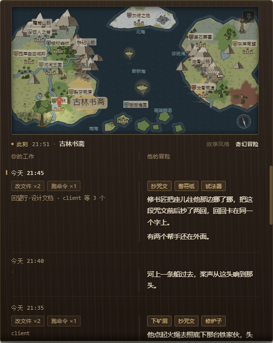

# 门后 · dsh-game-adventure

> 你在这一头干活，他在那一头过日子。你们用的是同一个下午。



DSH 的陪伴类插件。右下角一扇 64×64 的小木门，推开是一张世界地图：一个人这会儿在古林书斋里抄一页咒文、在院子里试一件法器，或者已经出了门。

地图下面是一行状态（`此刻 · 时间 · 地点`），再往下是**见闻录**——每一行从中间分开：

- **左边**：你今天干了什么，只有名词和数字
- **右边**：他那头发生的事，用句子讲

不用点任何东西，一眼就能看完。

---

## 装

```bash
dsh plugin add dsh-game-adventure
```

装完重启 DSH，右下角就会出现那扇小木门。

想先看看它长什么样，不用装：

```bash
node scripts/build-client.mjs
node scripts/preview.mjs        # http://127.0.0.1:5180
```

---

## 它做什么

- **只读元数据**：工具名、时间、文件名，不碰你的对话内容，不读代码
- **零 token**：不走任何模型，「他会说什么」是写好的句子按当时的账挑出来的
- **本地-only**：记录写在 `~/.dsh/gameflow/records.json`，不上传任何数据
- **只讲今天**：见闻录只铺今天这一天，昨天及更早的自动收走（存档里也只留今天）

## 它刻意不做

不做事、不做成就、不加红点、不发通知、不弹窗。

不做任务系统，不做连续天数，不分析你的内容。

**数字和故事的界线，就是它跟「效率工具」的界线**：左栏可以有数字，右栏只能是句子。

---

## 主题与故事包

两套主题：**木与铜**（默认）、**古籍图书馆**。跟着系统亮/暗色走，也跟着钟点走——入夜之后地图自己暗下去。

故事包目前只有一套完整的（奇幻冒险）。另有几套预留了名字，还没写。

---

## 关掉它

**临时关**（不用重启）：双击桌面上的「门后 开关」——15 秒内那扇门从页面上消失，也不再记录。

**彻底卸载**：

```bash
dsh plugin remove dsh-game-adventure
```

---

## 自检

不需要装任何东西，用仓库自带的脚本就能跑：

```bash
node scripts/build-client.mjs   # 重建 lib/client.js
node scripts/smoke.mjs          # 断言
node scripts/look.mjs           # 四个窗口尺寸的版面
node scripts/e2e.mjs            # 真链路（跑完确认没动你那份 records.json）
```

---

## 许可

MIT
